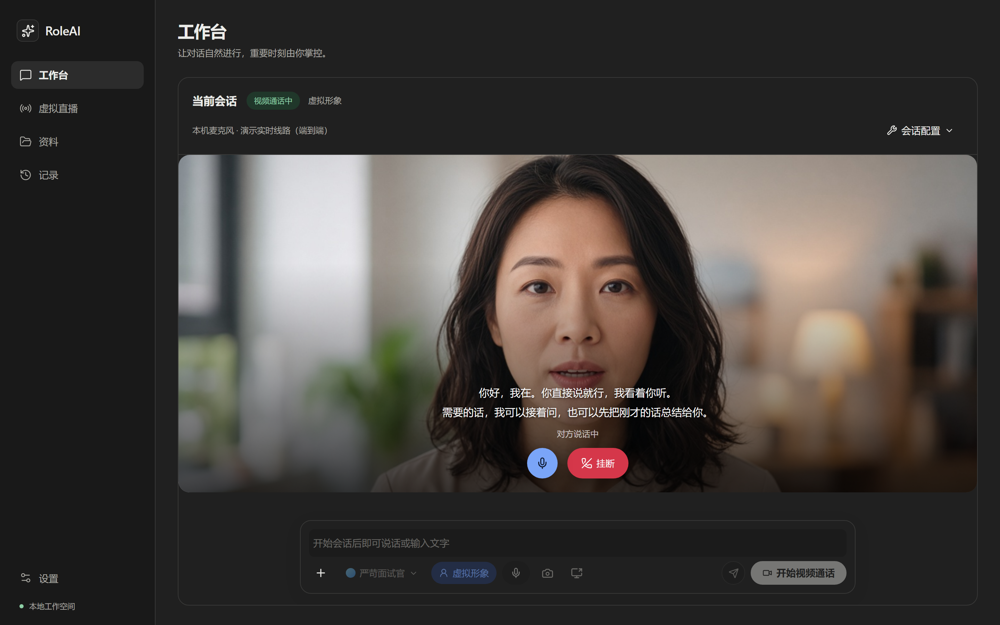
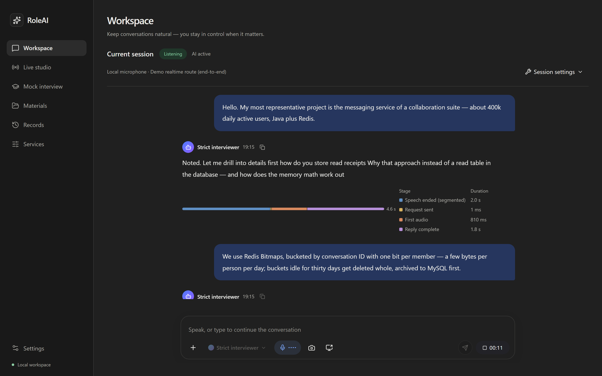
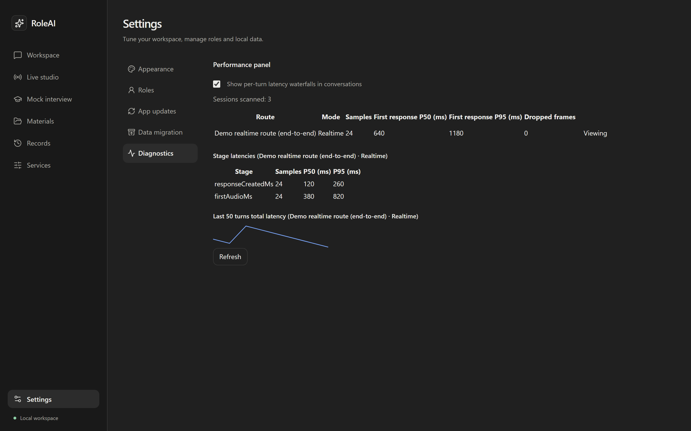
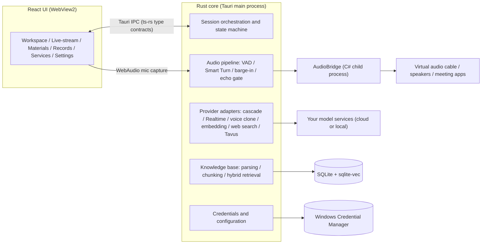
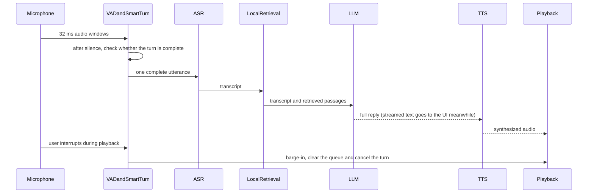
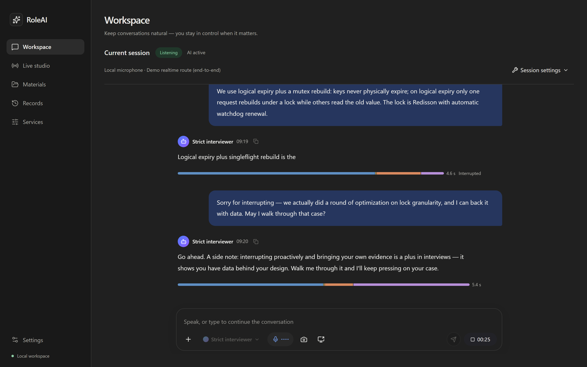
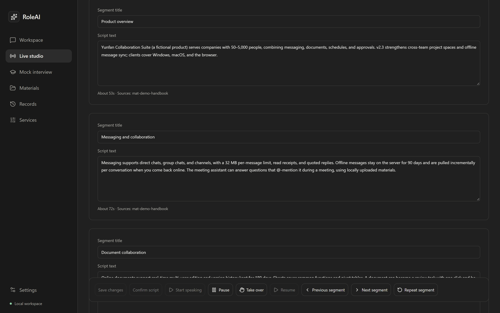

<h1 align="center">RoleAI</h1>

<p align="center">
  <a href="README.md">简体中文</a> | English
</p>

<p align="center">
  <a href="https://notintosports.github.io/RoleAI/demo/">Live demo</a> ·
  <a href="guide/README.md">Docs</a> ·
  <a href="guide/benchmarks.md">Benchmarks</a> ·
  <a href="guide/adr/README.md">Design decisions</a>
</p>

<p align="center">
  
</p>

<p align="center"><strong>A local-first, full-duplex real-time voice agent for Windows. One Rust + Tauri desktop app: you talk, the role listens, answers, and can be interrupted. Give a role a face and it appears on camera as a digital human.</strong></p>

<p align="center">
  <a href="https://github.com/NotIntoSports/RoleAI/actions/workflows/ci.yml"></a>
  
  
  
  
  
</p>

## RoleAI in 30 seconds

RoleAI is a real-time voice conversation system that runs on your machine. The hard part is not chaining ASR, LLM, and TTS together; it is **turn-taking**. The AI must not jump in when you pause mid-sentence, must stop the moment you interrupt, and must not mistake its own voice, picked up by the microphone, for you. All of this is handled in a Rust audio pipeline and measured with reproducible benchmarks and offline evaluations.

Stack: Rust (Tauri 2 main process: audio pipeline, session orchestration, provider adapters, local retrieval), React 19 (WebView UI), C# (meeting-audio child process), SQLite + sqlite-vec (local data and vector search). Roughly 53k lines of Rust and 20k lines of TypeScript, with about 725 Rust tests.

| Metric | Result | Source |
| --- | --- | --- |
| Audio hot path (ingest, VAD, segmentation, barge-in) | Over 370x real time; Silero inference median ≈80 µs per 32 ms window | [Criterion benchmarks](guide/reports/benchmarks.md) |
| Barge-in first-trigger latency | Median 217 ms, 4/4 real interruptions detected (synthetic corpus) | [Audio evaluation](guide/reports/audio-eval.md) |
| Value of two-stage turn detection | Premature cutoffs on mid-sentence hesitation: 50% down to 25% (synthetic corpus) | [Audio evaluation](guide/reports/audio-eval.md) |
| Local hybrid retrieval | Median 0.48 ms over 4,904 chunks | [Criterion benchmarks](guide/reports/benchmarks.md) |

Every number comes from scripts in this repository, run on an Intel Core Ultra 7 255H laptop. See [Benchmarks](guide/benchmarks.md) for the environment and limitations.



> Screenshots are generated automatically from the built-in demo mode: scripted conversations with fictional data, no AI services connected. The [live demo](https://notintosports.github.io/RoleAI/demo/) runs the real UI against a mocked backend in your browser, no install needed.

## Core engineering problems

### 1. When is the user done? Two-stage turn detection

**Problem**: if silence alone ends a turn, the AI cuts in every time the user pauses half a second to find a word.

**Approach**: stage one, Silero VAD (16 kHz, 32 ms windows), decides whether someone is speaking. Once silence appears, stage two, a Smart Turn completeness model (ONNX int8, bundled with the app), decides whether the utterance is complete in content and intonation. If it is not, the pipeline keeps waiting.

**Evidence**: in the offline evaluation, premature cutoffs on mid-sentence hesitation fell from 50% (VAD only) to 25% (VAD + Smart Turn). Smart Turn takes a median 68.2 ms on a 4-second segment and runs once per turn.

**Code**: [audio/vad.rs](src-tauri/src/audio/vad.rs), [audio/smart_turn.rs](src-tauri/src/audio/smart_turn.rs)

### 2. Barge-in without self-answering: the echo gate

**Problem**: while the AI speaks, the speakers leak into the microphone. Get this wrong and the AI either cannot hear the user interrupt, or treats its own words as a new question and answers itself in a loop.

**Approach**: during playback, a sliding window of voiced frames plus an energy check detects real interruptions and immediately clears the playback queue. At the text level, each transcription is compared with what the AI just said using bigram Dice similarity; at 0.85 or above it is treated as echo and the whole turn is dropped.

**Evidence**: on the synthetic corpus, 4/4 real interruptions were detected with a median first-trigger latency of 217 ms.

**Code**: [audio/barge_in.rs](src-tauri/src/audio/barge_in.rs), [services/echo_guard.rs](src-tauri/src/services/echo_guard.rs)

### 3. Two voice transports and connection recovery

**Problem**: end-to-end Realtime models are fast, but few providers offer them and each speaks a different protocol. A cascade is flexible but adds a hop. Long-lived connections also drop.

**Approach**:
- The cascade mode connects ASR, LLM, and TTS each to any OpenAI-compatible service, with bounded retries for connection errors and HTTP 429/502/503/504.
- The Realtime mode runs a full-duplex WebSocket with adapters for the OpenAI, Alibaba DashScope, and Zhipu protocol dialects.
- A dropped connection reconnects with exponential backoff (500 ms base, 30 s cap), then replays the conversation with per-item confirmation, skipping the assistant's own turns. This fixed a Qwen disconnect-reconnect loop.

**Code**: [providers/cascade.rs](src-tauri/src/providers/cascade.rs), [providers/realtime_protocol.rs](src-tauri/src/providers/realtime_protocol.rs), [providers/realtime_session.rs](src-tauri/src/providers/realtime_session.rs)

### 4. Making latency visible: a per-turn timeline

**Problem**: users say "it feels slow"; they cannot tell whether the time went to turn detection, retrieval, the LLM's first token, or TTS.

**Approach**: both transports record per-stage timings (`TurnTimeline`) persisted with session events. The same data drives the latency waterfall under each reply, a performance panel with p50/p95 per transport, and CSV or Chrome Trace exports (load them in [Perfetto](https://ui.perfetto.dev)). Exports contain no prompts, credentials, or audio.

| Latency waterfall | Performance panel |
| --- | --- |
|  |  |

**Code**: [services/realtime_pump/shared.rs](src-tauri/src/services/realtime_pump/shared.rs); see the [latency observability guide](guide/latency.md).

### 5. Local RAG without a vector database

**Problem**: a desktop app cannot ask users to install a separate vector database.

**Approach**: PDF, DOCX, and plain text are chunked by section; SQLite FTS5 full-text search and sqlite-vec vector search run side by side and are merged with reciprocal rank fusion (RRF). The vector table is rebuilt automatically when the embedding dimensions change.

**Evidence**: median 0.48 ms per query over 4,904 chunks; a 50-question offline set validates the retrieval mechanics ([RAG evaluation](guide/reports/rag-eval.md)).

**Code**: [materials/hybrid.rs](src-tauri/src/materials/hybrid.rs)

### 6. From five processes to one exe, guarded by tests

**Problem**: the project began as a multi-process Electron + Next.js + Go + Python system; users had to run four or five processes to get a single voice answer.

**Approach**: it was consolidated into one Tauri app, keeping a single-purpose C# AudioBridge child process for meeting audio capture. The architectural promises were then written down as tests:
- A packaged smoke test launches the installed exe and asserts the process tree contains no Node, Go, Python, PostgreSQL, or Nginx.
- ts-rs generates frontend types from Rust DTOs ([src/generated/bindings.ts](src/generated/bindings.ts)); changing a field on one side breaks the build.
- The capability whitelist and IPC command surface are hash-pinned in a [security surface baseline](tests/tauri/security-surface-baseline.json); any drift fails the suite.
- onnxruntime is statically linked at build time so the app never loads a stale DLL from the system directory, a bug we actually hit.
- API keys live only in Windows Credential Manager, in-memory copies are wiped with `zeroize`, and the UI and config files only hold key references.

The full retrospective: [From five processes to one exe](guide/blog/2026-09-30-five-processes-to-one-exe.md) (Chinese).

## Architecture



One conversational turn in cascade mode, including the barge-in path:



In Realtime mode, recognition, generation, and synthesis are handled by an end-to-end model over one WebSocket connection.

More detail: [architecture](guide/architecture.md) and [real-time voice pipeline](guide/realtime-voice-pipeline.md) (Chinese).

## Design decisions

The key trade-offs are recorded as [architecture decision records (ADRs, in Chinese)](guide/adr/README.md), each with context, alternatives, the decision, and its costs. For example: why the project [consolidated multiple processes into one Tauri app](guide/adr/0001-single-tauri-app.md), why it [uses SQLite + sqlite-vec instead of a standalone vector database](guide/adr/0003-sqlite-sqlite-vec.md), and why [cascade and Realtime modes coexist](guide/adr/0004-cascade-and-realtime-dual-mode.md).

Three [technical posts](guide/blog/README.md) (in Chinese) cover the pitfalls behind the implementation.

## Roles: digital humans that talk and appear on camera

In RoleAI, the digital human is the **role**. A role consists of a name, a system prompt, an opening line, a speaking style, and an optional video face. Without a face it is a voice conversation partner; with one it appears on camera, looking at you while it listens and answers. Built-in roles work as-is, or you can save a copy and make it your own.

### Built-in roles and scenarios

- **Interview practice**: Interviewer, Strict Interviewer, HR, Candidate Partner, and Speaking Coach ask follow-up questions grounded in the JD and résumé from your knowledge base. The prompts only use the experience you provide: no fabricated résumés, no hiring decisions.
- **Front desk**: receives visitors or callers and answers from designated product, service, business-hours, address, and process materials. When the materials do not contain an answer, it says so and hands off to a human instead of inventing prices, stock, policies, or promises.
- **Meeting assistant**: AudioBridge captures loopback audio from a chosen meeting process, and the role answers call-outs from the meeting context and designated documents, separating facts, assumptions, and open questions. During a session the system default microphone (all three default roles) is temporarily switched to the virtual audio cable, so meeting apps left on "default device" receive the AI's voice; each default role is restored when the session ends, and the default playback device is never changed. One click switches back to your own microphone.
- **Live-stream presenter**: generates a segmented script from local product materials and presents it segment by segment after you confirm; no invented prices, stock, or promises. The stage shows an image or a looping video.
- **Custom roles**: write your own prompt and opening line; role names are globally unique.

All roles share the same voice pipeline and local data: documents, indexes, and session records stay in a local SQLite database, and every session produces an evidence-cited summary. The voice chain can use cloud services, or stay entirely on your machine with the Ollama, LM Studio, speaches (local Whisper), and Kokoro-FastAPI (local TTS) presets. See the [local models guide](guide/local-models.md).

| Workspace | Live-stream |
| --- | --- |
|  |  |

### Cloning a voice and a face

- **Voice**: under Settings → Voice cloning, upload a reference recording and create a voice through Zhipu (upload, then clone) or Alibaba DashScope (including one-call qwen enrollment), then assign the voice to a voice route so the role speaks with it.
- **Face**: RoleAI lists every face (replica) in your Tavus account for roles to use. If you train a personal replica from your own recorded video on the Tavus platform, it shows up in the same list and can be assigned to any role.

Cloned voices and faces must belong to you or to someone who has given consent, and the people you talk to should be told they are talking to an AI.

### Putting a role on camera: two face sources

**Cloud: Tavus (supported)**

Save your key under Settings → Video call (Tavus), pick a face for the role under Settings → Roles, then turn on Avatar in the Workspace input bar and press Start video call. No local GPU is needed; usage is billed to your Tavus account. During a call the role persona is sent to Tavus and audio/video go through a Daily room. See the [configuration guide](guide/configuration.md) for setup and [security](guide/security.md) for data flows.

**Local: [SoulX-LiveAct](https://github.com/Soul-AILab/SoulX-LiveAct) (planned, no cloud API calls)**

SoulX-LiveAct is an open real-time digital-human video model from Soul AILab (18B parameters: Wan2.1 14B plus a 4B audio module), suited to cases where you do not want to hand the role's persona and audio/video to a third party. RoleAI does **not integrate it yet**. Below is what a standalone deployment needs; the figures come from its official README and issues, not from RoleAI's own measurements.

Hardware:

| Setup | Officially reported performance |
| --- | --- |
| 2x H100 or H200 | Real-time streaming, 20 FPS at 720×416 or 512×512 |
| 1x RTX 4090 or RTX 5090 | Requires `--fp8_kv_cache --block_offload --t5_cpu`; about 6 FPS on a single 5090, not real time |
| 2x RTX 5090 with FP4 | Possibly real time according to the authors, still being investigated ([issue #2](https://github.com/Soul-AILab/SoulX-LiveAct/issues/2)) |

You also need about 110 GB of disk for the weights (the storage used by the [Hugging Face repository](https://huggingface.co/Soul-AILab/LiveAct)).

Setup (official steps; the commands are Linux/bash style and vllm does not support native Windows, so Windows users need WSL2 or a separate Linux GPU server):

```bash
conda create -n liveact python=3.10 && conda activate liveact
pip install -r requirements.txt
conda install conda-forge::sox -y
# FP8 attention kernel
git clone https://github.com/thu-ml/SageAttention.git && cd SageAttention && git checkout v2.2.0 && python setup.py install && cd ..
# FP8 GEMM kernel
pip install vllm==0.11.0
# LightVAE
git clone https://github.com/ModelTC/LightX2V && cd LightX2V && python setup_vae.py install && cd ..
```

Then download the [Soul-AILab/LiveAct](https://huggingface.co/Soul-AILab/LiveAct) and [chinese-wav2vec2-base](https://huggingface.co/TencentGameMate/chinese-wav2vec2-base) weights and launch with `generate.py` (command line) or `demo.py` (GUI demo) as described in the official README.

License: the model weights are Apache-2.0; the code repository has no license declared on GitHub, so confirm with the authors before commercial use.

## Getting started

No installer has been published yet (pushing a `v*` tag makes the Release workflow build a Windows installer with SHA256 checksums), so build from source.

Requirements: Windows x64, [Rust 1.96](https://www.rust-lang.org/), [Node.js 24](https://nodejs.org/), the [Microsoft Edge WebView2 Runtime](https://developer.microsoft.com/microsoft-edge/webview2/), and the .NET 10 SDK (to build AudioBridge).

```powershell
npm install
npm run tauri:dev      # develop
npm run tauri:build    # produce the installer
```

First run:

1. **Configure a provider**: in Settings → Model providers, pick a preset or enter a custom URL, save the API key (it goes into Credential Manager), and press Test. Local model presets work too.
2. **Pick a role**: choose a built-in role on the Workspace, or write your own prompt and opening line.
3. **Start a session**: start it, allow microphone access, and speak. Before rehearsing with an interviewer role, import your résumé and the job description on the Materials page.

See the [configuration guide](guide/configuration.md) for more and [troubleshooting](guide/troubleshooting.md) if something goes wrong.

## Tests and quality

```powershell
npm run test:tauri          # full gate
npm run test:tauri-package  # packaged smoke test
```

- `test:tauri` runs the Rust unit tests (about 725, including proptest property tests), the frontend vitest suite, and the Node contract tests, then builds the frontend.
- `test:tauri-package` launches the packaged exe in an isolated temporary config directory, waits for the main window, and asserts that the process tree and install directory are clean.
- Contract tests pin several regressions: only `src/api/commands.ts` may call the Tauri IPC; drift in the capability whitelist or hash-pinned files fails the suite; the README and CI may only describe the single Tauri product path.
- Performance and quality: Criterion benchmarks (`powershell -File scripts/run-benchmarks.ps1`), offline evaluations for turn detection, barge-in, and RAG, plus [coverage](guide/reports/coverage.md) and [mutation testing](guide/reports/mutation.md) reports.
- CI: the full suite on Windows, and `cargo check --all-targets` plus unit tests on Linux and macOS for every commit; CodeQL and OpenSSF Scorecard also run. See [.github/workflows/](.github/workflows/ci.yml).

## Known limitations

- The audio evaluation corpus is synthesized with Windows SAPI and is cleaner than real speech; the echo scenarios do not model AEC, so false-trigger numbers are a lower bound for when AEC fails.
- The RAG evaluation uses character-bigram hash stand-in vectors; it validates the retrieval mechanics, not the semantic recall of a real embedding model.
- The median end-of-turn commit delay is 2,340 ms, above the 700 ms silence threshold the design targets, mostly due to the segmenter's hold-state budget; the evaluation surfaced it as a tuning item.
- AudioBridge, Credential Manager, and the default-microphone takeover are Windows implementations; macOS and Linux are only guaranteed to compile and pass unit tests.
- The default-microphone takeover uses the undocumented `IPolicyConfig` COM interface and needs regression checks after major Windows updates.
- The installer is not code-signed yet.

## Roadmap

- [x] Full-duplex real-time voice sessions (cascade + Realtime modes)
- [x] Silero VAD + Smart Turn two-stage turn detection, echo gate, barge-in
- [x] Local knowledge base (PDF / DOCX / text, hybrid retrieval)
- [x] Per-turn latency waterfall, performance panel, and latency exports (CSV / Chrome Trace)
- [x] Benchmark and offline evaluation reports
- [x] Local model presets (Ollama / LM Studio / local Whisper / local TTS)
- [x] Tavus cloud digital-human video calls
- [ ] Local digital-human backend: integrate SoulX-LiveAct (no cloud API calls)
- [ ] First official Release and automatic updates (manual "check for updates" is in Settings; enabled once the release signing key is configured)
- [ ] Managed OBS, one-click virtual camera, and hotkey UI — deferred; the client currently only resolves local OBS / AudioBridge paths and probes prerequisites, and never creates scenes, browser sources, or starts the Virtual Camera
- [ ] Full macOS / Linux support

## Project layout

```
├── src/                    # React frontend
│   ├── screens/            # The six pages (workspace, live-stream, materials, records, services, settings)
│   ├── features/           # Session, roles, materials, live-stream, Tavus, diagnostics modules
│   ├── api/                # The single Tauri IPC entry point (commands.ts)
│   ├── demo/               # Mocked backend for the live demo
│   └── generated/          # ts-rs generated types (do not edit by hand)
├── src-tauri/              # Rust core
│   ├── src/audio/          # Capture, VAD, Smart Turn, segmentation, barge-in
│   ├── src/providers/      # Cascade / Realtime / voice clone / embedding / search / Tavus adapters
│   ├── src/services/       # Session orchestration, echo gate, roles, voice routes
│   ├── src/materials/      # Document parsing, chunking, hybrid retrieval, backup
│   ├── src/secrets/        # Credential Manager wrapper
│   ├── benches/ examples/  # Criterion benchmarks and offline evaluations
│   └── capabilities/       # Tauri capability whitelist (pinned by the security baseline)
├── native/AudioBridge/     # C# meeting-audio child process (NAudio.Wasapi)
├── tests/tauri/            # Node contract tests
└── guide/                  # Docs, ADRs, technical posts, evaluation reports
```

## Responsible use

RoleAI is built for practice, assistance, and content creation. When you use it in a meeting or a live stream, tell participants how AI is involved and how the session is recorded, and have a human review its output. Make sure you have consent for any face and voice used for a digital human.

## Name and compatibility

The app is called **RoleAI**; the Windows executable is `role-ai-desktop.exe`. To keep reading existing configuration and data, the original app identifier, the `%APPDATA%\AI Virtual Assistant` config directory, and the `AI_VIRTUAL_ASSISTANT_CONFIG` environment variable are unchanged.

## Acknowledgements and license

Built on [Tauri](https://github.com/tauri-apps/tauri), [React](https://github.com/facebook/react), [Vite](https://github.com/vitejs/vite), [rusqlite](https://github.com/rusqlite/rusqlite), [sqlite-vec](https://github.com/asg017/sqlite-vec), [Silero VAD](https://github.com/snakers4/silero-vad) (via [silero-vad-rust](https://github.com/sheldonix/silero-vad-rust) and [ort](https://github.com/pykeio/ort)), [smart-turn](https://huggingface.co/pipecat-ai) by pipecat-ai, [NAudio.Wasapi](https://github.com/naudio/NAudio), [pdf-extract](https://github.com/jrmuizel/pdf-extract), [docx-rs](https://github.com/bokuweb/docx-rs), [keyring](https://github.com/hwchen/keyring-rs), [lucide](https://github.com/lucide-icons/lucide), and more; see [THIRD_PARTY_NOTICES.md](THIRD_PARTY_NOTICES.md) for the full list.

The code is released under the [MIT license](LICENSE).
