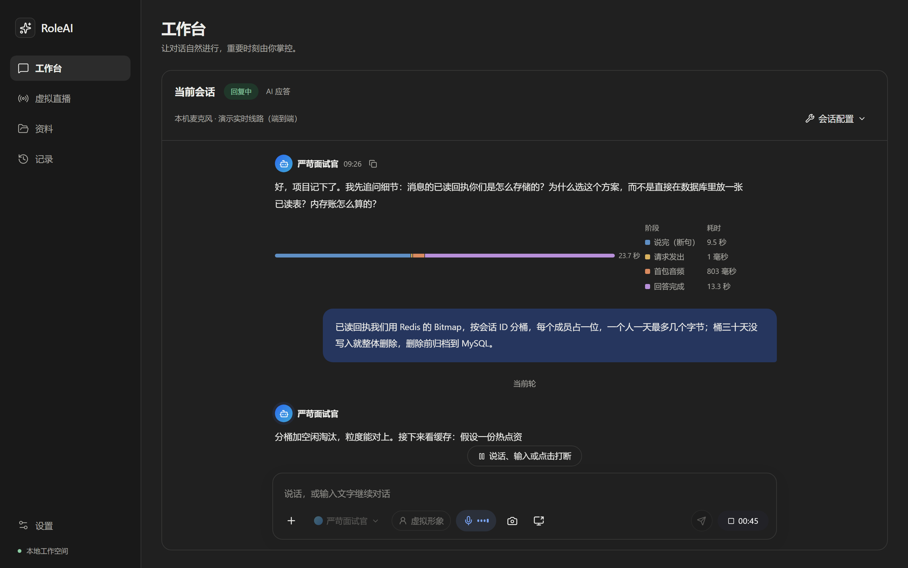
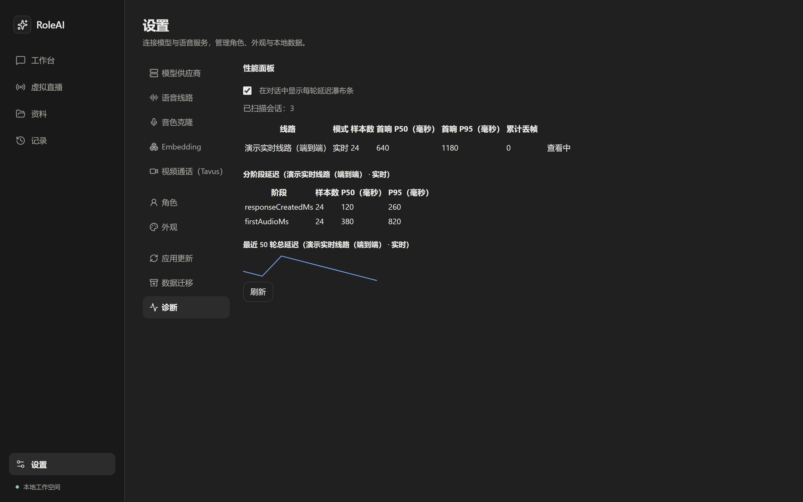
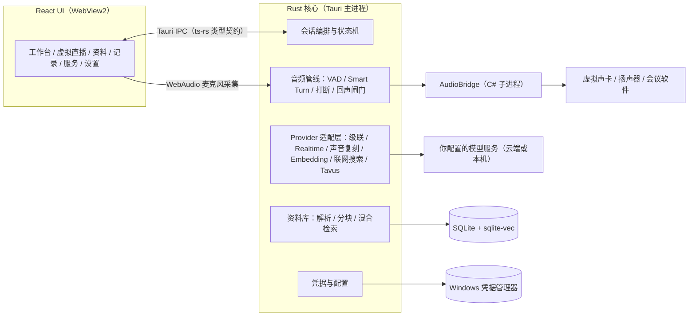
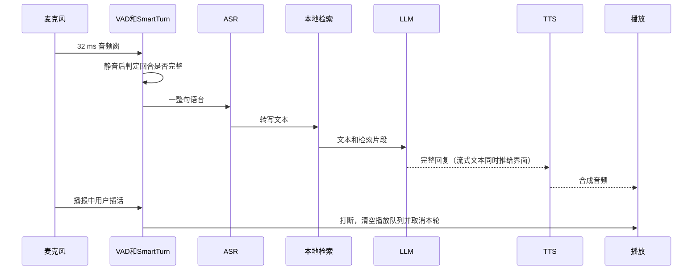
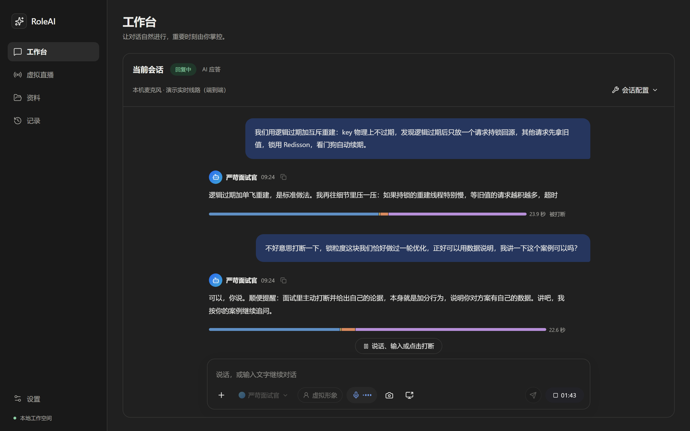
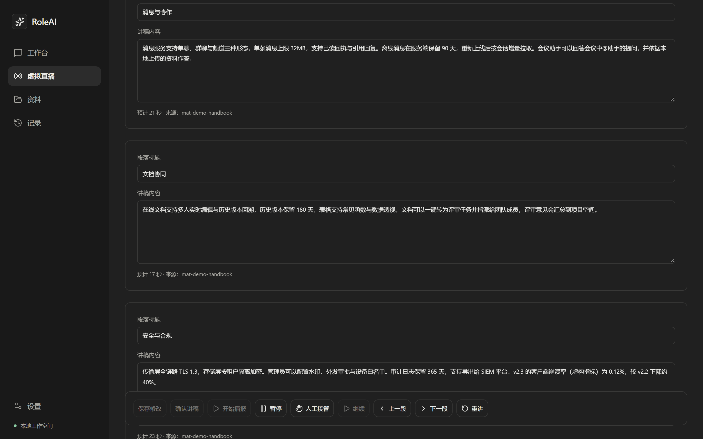

<h1 align="center">RoleAI</h1>

<p align="center">
  <a href="README.en.md">English</a> ·
  <a href="https://notintosports.github.io/RoleAI/demo/">在线演示</a> ·
  <a href="guide/README.md">文档</a> ·
  <a href="guide/benchmarks.md">基准与评测</a> ·
  <a href="guide/adr/README.md">架构决策</a>
</p>

<p align="center">
  
</p>

<p align="center"><strong>Windows 上本地优先的全双工实时语音智能体。Rust + Tauri 单一桌面应用：你说话，角色听、接话、能被打断；配上形象，角色就以数字人出镜。</strong></p>

<p align="center">
  <a href="https://github.com/NotIntoSports/RoleAI/actions/workflows/ci.yml"></a>
  
  
  
  
  
</p>

## 30 秒看懂

RoleAI 是一个跑在本机的实时语音对话系统。难点不在"把 ASR、LLM、TTS 串起来"，而在**轮流说话**：用户句中停顿时不能抢答，用户插话时 AI 要立刻停下，AI 自己的声音被麦克风收回去时不能当成用户在说话。这些都在 Rust 音频管线里解决，并用可复现的基准和离线评测量化。

技术栈：Rust（Tauri 2 主进程，音频管线、会话编排、模型适配、本地检索）、React 19（WebView 界面）、C#（会议音频子进程）、SQLite + sqlite-vec（本地数据与向量检索）。代码约 5.3 万行 Rust、2 万行 TypeScript，725 个 Rust 测试。

| 指标 | 结果 | 出处 |
| --- | --- | --- |
| 音频热路径（摄入、VAD、分段、打断） | 实时因子 370 倍以上，Silero 单窗推理中位约 80 µs（每窗 32 ms 音频） | [Criterion 基准](guide/reports/benchmarks.md) |
| 打断（barge-in）首次触发延迟 | 中位 217 ms，真实打断 4/4 检出（合成语料） | [音频离线评测](guide/reports/audio-eval.md) |
| 两级断句的价值 | 句中犹豫场景过早截断率 50% 降到 25%（合成语料） | [音频离线评测](guide/reports/audio-eval.md) |
| 本地混合检索 | 4904 个分块规模下中位 0.48 ms | [Criterion 基准](guide/reports/benchmarks.md) |

所有数字由仓库里的脚本在一台 Intel Core Ultra 7 255H 笔记本上跑出，测试环境和局限见[基准与评测报告](guide/benchmarks.md)。


> 截图由内置演示模式自动生成：脚本化对话与虚构数据，未连接任何 AI 服务。[在线演示](https://notintosports.github.io/RoleAI/demo/)在浏览器里运行真实界面和模拟后端，免安装。

## 核心工程问题

### 1. 什么时候算"说完了"：两级断句

**问题**：只靠静音判断回合结束，用户想词时停顿半秒就会被抢答。

**做法**：第一级用 Silero VAD（16 kHz、32 ms 窗）判断"有没有在说话"；静音出现后，第二级用 Smart Turn 回合完成度模型（ONNX int8，随包分发）判断"这句话在语义和语调上是否完整"，不完整就继续等。

**证据**：离线评测中，句中犹豫场景的过早截断率从 50%（只用 VAD）降到 25%（VAD + Smart Turn）。Smart Turn 对 4 秒语音段的判定中位 68.2 ms，每轮只触发一次。

**代码**：[audio/vad.rs](src-tauri/src/audio/vad.rs)、[audio/smart_turn.rs](src-tauri/src/audio/smart_turn.rs)

### 2. 打断与"自问自答"：回声闸门

**问题**：AI 说话时，扬声器的声音会被麦克风收回去。处理不好，AI 要么听不见用户插话，要么把自己的话当成用户提问，陷入自问自答。

**做法**：播报期间用滑动窗统计有声帧并辅以能量判定来识别真实插话，触发后立刻清空播放队列。文本层再把转写结果和 AI 刚说过的话做 bigram Dice 相似度比较，达到 0.85 就判为回声并整轮丢弃。

**证据**：合成语料中真实打断 4/4 检出，首次触发延迟中位 217 ms。

**代码**：[audio/barge_in.rs](src-tauri/src/audio/barge_in.rs)、[services/echo_guard.rs](src-tauri/src/services/echo_guard.rs)

### 3. 两条语音线路与断线恢复

**问题**：端到端 Realtime 模型延迟低但供应商少、协议各不相同；级联方案灵活但多一跳延迟。长连接还会断。

**做法**：
- 级联模式把 ASR、LLM、TTS 三个阶段分别接到任意 OpenAI 兼容服务，对连接错误和 429/502/503/504 做有界重试。
- Realtime 模式走 WebSocket 全双工长连接，适配了 OpenAI、阿里云 DashScope、智谱三种协议方言。
- 断线按指数退避重连（500 ms 起、30 s 封顶），重连后逐条确认回放上下文并跳过 AI 自己的轮次。这修复了 qwen 断连后反复重连的死循环。

**代码**：[providers/cascade.rs](src-tauri/src/providers/cascade.rs)、[providers/realtime_protocol.rs](src-tauri/src/providers/realtime_protocol.rs)、[providers/realtime_session.rs](src-tauri/src/providers/realtime_session.rs)

### 4. 延迟看得见：每轮时间线

**问题**：用户只会说"反应慢"，不会说慢在断句、检索、LLM 首 token 还是 TTS。

**做法**：两条线路都按阶段打点（`TurnTimeline`），随会话事件持久化。同一份数据驱动每轮回复下方的延迟瀑布条、按线路汇总 p50/p95 的性能面板，以及 CSV 和 Chrome Trace 导出（可拖进 [Perfetto](https://ui.perfetto.dev) 看时间线）。导出不含提示词、凭据和音频。

| 延迟瀑布 | 性能面板 |
| --- | --- |
|  |  |

**代码**：[services/realtime_pump/shared.rs](src-tauri/src/services/realtime_pump/shared.rs)，说明见[延迟可观测性指南](guide/latency.md)。

### 5. 不装向量数据库的本地 RAG

**问题**：桌面应用不能要求用户再装一个向量数据库。

**做法**：PDF、DOCX、纯文本按章节语义分块，SQLite FTS5 全文检索和 sqlite-vec 向量检索两路召回，用倒数排序融合（RRF）合并。Embedding 维度变化时自动重建向量表。

**证据**：4904 个分块规模下检索中位 0.48 ms；50 题离线题集验证检索机制（[RAG 评测](guide/reports/rag-eval.md)）。

**代码**：[materials/hybrid.rs](src-tauri/src/materials/hybrid.rs)

### 6. 从五个进程到一个 exe，并用测试守住

**问题**：项目最早是 Electron + Next.js + Go + Python 的多进程系统，用户要跑四五个进程才能得到一次语音回答。

**做法**：收敛为单一 Tauri 应用，只保留一个职责单一的 C# AudioBridge 子进程做会议音频采集。然后把架构承诺写成测试：
- 打包冒烟测试启动安装后的 exe，断言进程树里没有 Node、Go、Python、PostgreSQL 或 Nginx。
- ts-rs 从 Rust DTO 生成前端类型（[src/generated/bindings.ts](src/generated/bindings.ts)），字段改一边就编译失败。
- 能力白名单和 IPC 命令面的文件哈希锁定在[安全面基线](tests/tauri/security-surface-baseline.json)里，漂移即红测。
- onnxruntime 构建期静态链接，避免运行时误加载系统目录里的旧版 DLL（真实踩过的坑）。
- API Key 只存 Windows 凭据管理器，内存副本用 `zeroize` 清零，界面和配置文件里只有密钥引用。

过程复盘见[《从五个进程到一个 exe》](guide/blog/2026-09-30-five-processes-to-one-exe.md)。

## 架构



一轮对话（级联模式）的时序，包括打断路径：



Realtime 模式下，识别、生成和合成由同一条 WebSocket 长连接上的端到端模型完成。

更多细节见[架构说明](guide/architecture.md)和[实时语音管线](guide/realtime-voice-pipeline.md)。

## 设计决策

关键取舍都记录在[架构决策记录（ADR）](guide/adr/README.md)里，每篇写明背景、备选方案、决策和代价。例如为什么[从多进程收敛为单一 Tauri 应用](guide/adr/0001-single-tauri-app.md)、为什么[用 SQLite + sqlite-vec 而不是独立向量数据库](guide/adr/0003-sqlite-sqlite-vec.md)、为什么[级联和 Realtime 两种模式并存](guide/adr/0004-cascade-and-realtime-dual-mode.md)。

实现背后的踩坑见三篇[技术文章](guide/blog/README.md)。

## 角色：能说话、能出镜的数字人

RoleAI 里的数字人就是**角色**。一个角色由名称、系统提示词、开场白、说话风格和可选的视频形象组成：没配形象时它是语音对话伙伴，配了形象就以数字人出镜，看着你听、接着回答。内置角色可以直接用，也可以另存一份改成自己的。

### 内置角色与场景

- **面试对练**：面试官、严苛面试官、HR、求职者陪练、表达教练，结合资料库里的 JD 和简历追问。提示词要求只依据你提供的真实经历提问，不编造履历、不作录用决定。
- **客服前台**：接待来访或来电客户，依据指定的产品、服务、营业时间、地址和办理流程资料回答；资料不足时明确说明并转人工，不编造价格、库存、政策或承诺。
- **会议助手**：AudioBridge 对指定会议进程做本机回环采集，角色根据会议上下文和指定资料回答点名提问，区分事实、推测和待确认事项。会话期间临时把系统默认麦克风（三个默认角色）切到虚拟声卡，会议软件保持"默认设备"就能收到 AI 语音，会话结束按角色还原；默认播放设备不动。可一键切回自己的麦克风。
- **直播讲解员**：从本地产品资料生成分段讲稿，逐段确认后讲解，不编造价格、库存或效果承诺。舞台可用图片或循环视频。
- **自定义角色**：自己写提示词和开场白，角色名全局唯一。

所有角色共用同一条语音管线和本地数据：资料、索引、会话记录都存本机 SQLite，每次会话生成带证据引用的纪要；语音链路可以接云端服务，也可以用 Ollama、LM Studio、speaches（本地 Whisper）、Kokoro-FastAPI（本地 TTS）四套预设完全留在本机，见[本地模型指南](guide/local-models.md)。

| 工作台 | 虚拟直播 |
| --- | --- |
|  |  |

### 克隆声音与形象

- **声音**：在「设置 → 音色克隆」上传一段参考音频，通过智谱（上传后克隆两步）或阿里云 DashScope（含 qwen 单次调用复刻）生成音色，再把音色配到语音线路上，角色就用这个声音说话。
- **形象**：RoleAI 会列出你 Tavus 账户里的全部形象供角色选用。在 Tavus 平台用自己录制的视频训练出个人形象后，它同样会出现在列表里，可以分配给任意角色。

克隆的声音和形象必须来自本人或已获授权的人，使用时请告知对话对象这是 AI。

### 让角色出镜：两种形象来源

**云端：Tavus（已支持）**

在「设置 → 视频通话（Tavus）」保存密钥，在「设置 → 角色」里给角色选一个形象，然后在工作台打开输入栏的「虚拟形象」开关，点「开始视频通话」。不需要本地 GPU，费用按你的 Tavus 账户结算。通话时角色人设会发给 Tavus，音视频经 Daily 房间传输。配置步骤见[配置指南](guide/configuration.md)，数据去向见[安全设计](guide/security.md)。

**本地：[SoulX-LiveAct](https://github.com/Soul-AILab/SoulX-LiveAct)（规划中，不调用任何云 API）**

SoulX-LiveAct 是 Soul AILab 开源的实时数字人视频生成模型（18B 参数，基于 Wan2.1 14B 加 4B 音频模块），适合不想把角色人设和音视频交给第三方的场景。RoleAI 目前**还没有内置接入**，下面是独立部署所需的条件，数据来自它的官方 README 和 issue，不是 RoleAI 的实测结果。

硬件需求：

| 配置 | 官方给出的表现 |
| --- | --- |
| 2 张 H100 或 H200 | 实时流式，720×416 或 512×512 下 20 FPS |
| 1 张 RTX 4090 或 RTX 5090 | 需开 `--fp8_kv_cache --block_offload --t5_cpu`；5090 单卡约 6 FPS，达不到实时 |
| 2 张 RTX 5090 + FP4 | 作者表示可能实时，仍在验证（[issue #2](https://github.com/Soul-AILab/SoulX-LiveAct/issues/2)） |

另外需要约 110 GB 磁盘放模型权重（[Hugging Face 仓库](https://huggingface.co/Soul-AILab/LiveAct)占用量）。

部署步骤（官方流程，命令为 Linux/bash 写法，vllm 不支持原生 Windows，Windows 用户需用 WSL2 或单独的 Linux GPU 服务器）：

```bash
conda create -n liveact python=3.10 && conda activate liveact
pip install -r requirements.txt
conda install conda-forge::sox -y
# FP8 注意力内核
git clone https://github.com/thu-ml/SageAttention.git && cd SageAttention && git checkout v2.2.0 && python setup.py install && cd ..
# FP8 GEMM 内核
pip install vllm==0.11.0
# LightVAE
git clone https://github.com/ModelTC/LightX2V && cd LightX2V && python setup_vae.py install && cd ..
```

然后下载 [Soul-AILab/LiveAct](https://huggingface.co/Soul-AILab/LiveAct) 和 [chinese-wav2vec2-base](https://huggingface.co/TencentGameMate/chinese-wav2vec2-base) 权重，按官方 README 用 `generate.py`（命令行）或 `demo.py`（GUI 演示）启动。

许可证：模型权重为 Apache-2.0；代码仓库在 GitHub 上没有标注许可证，商用前请自行向作者确认。

## 快速开始

目前还没有发布安装包（打 `v*` 标签后 Release 工作流会自动构建 Windows 安装包并附 SHA256 校验），请从源码构建。

环境要求：Windows x64、[Rust 1.96](https://www.rust-lang.org/)、[Node.js 24](https://nodejs.org/)、[Microsoft Edge WebView2 Runtime](https://developer.microsoft.com/microsoft-edge/webview2/)、.NET 10 SDK（构建 AudioBridge 用）。

```powershell
npm install
npm run tauri:dev      # 开发调试
npm run tauri:build    # 产出安装包
```

首次配置：

1. **配服务**：「设置 → 模型供应商」选预设或填自定义 URL，保存 API Key（进凭据管理器），点「测试」确认连通。也可以选本地模型预设。
2. **选角色**：在工作台选内置角色，或自定义提示词与开场白。
3. **开会话**：启动会话、授权麦克风后开口说话。用面试官角色对练前，先把简历和岗位资料导入「资料」页。

更多配置见[配置指南](guide/configuration.md)，遇到问题见[故障排查](guide/troubleshooting.md)。

## 测试与质量

```powershell
npm run test:tauri          # 全量门禁
npm run test:tauri-package  # 打包冒烟
```

- `test:tauri` 依次运行 Rust 单元测试（约 725 个，含 proptest 属性测试）、前端 vitest、Node 契约测试，最后构建前端产物。
- `test:tauri-package` 在隔离的临时配置目录里启动打包后的 exe，等主窗口可见，并断言进程树和安装目录都干净。
- 契约测试钉住几类回归：前端只有 `src/api/commands.ts` 能调用 Tauri IPC；能力白名单和关键文件哈希漂移即失败；README 与 CI 只描述单一 Tauri 产品路径。
- 性能与质量：Criterion 基准（`powershell -File scripts/run-benchmarks.ps1`）、断句/打断/RAG 离线评测、[覆盖率](guide/reports/coverage.md)和[变异测试](guide/reports/mutation.md)报告。
- CI：Windows 全量测试，Linux 和 macOS 每次提交跑 `cargo check --all-targets` 与单元测试；另有 CodeQL、OpenSSF Scorecard。见 [.github/workflows/](.github/workflows/ci.yml)。

## 已知局限

- 音频评测语料由 Windows SAPI 合成，比真人录音干净；回声场景没有建模 AEC，误触发数字代表 AEC 失效时的下界。
- RAG 评测用的是字符 bigram 哈希替身向量，只验证检索机制，不代表真实 Embedding 的语义召回。
- 句尾提交延迟中位 2340 ms，高于 700 ms 的静音判定设计值，主要由分段器的保持态预算造成，是评测暴露出来的待调参项。
- AudioBridge、凭据管理器、默认麦克风接管都是 Windows 实现；macOS 和 Linux 目前只保证编译和单元测试通过。
- 默认麦克风接管用的是未公开的 `IPolicyConfig` COM 接口，Windows 大版本更新后需要回归验证。
- 安装包尚未做代码签名。

## 路线图

- [x] 全双工实时语音会话（级联 + Realtime 双模式）
- [x] Silero VAD + Smart Turn 两级断句、回声闸门、打断
- [x] 本地知识库（PDF / DOCX / 文本，混合检索）
- [x] 每轮延迟瀑布、性能面板与延迟导出（CSV / Chrome Trace）
- [x] 基准测试与离线评测报告
- [x] 本地模型预设（Ollama / LM Studio / 本地 Whisper / 本地 TTS）
- [x] Tavus 云端数字人视频通话
- [ ] 本地数字人后端：接入 SoulX-LiveAct（不调用云 API）
- [ ] 首个正式 Release 与自动更新（设置页手动检查更新已就绪，配置发布签名公钥后启用）
- [ ] 托管 OBS、虚拟摄像头一键启停与快捷键 UI —— 已延期；当前客户端只做本机 OBS / AudioBridge 路径解析和前置探测，不会创建场景、浏览器源或启动 Virtual Camera
- [ ] macOS / Linux 完整支持

## 项目结构

```
├── src/                    # React 前端
│   ├── screens/            # 六个页面（工作台、虚拟直播、资料、记录、服务、设置）
│   ├── features/           # 会话、角色、资料、直播、Tavus、诊断等功能模块
│   ├── api/                # 唯一的 Tauri IPC 入口（commands.ts）
│   ├── demo/               # 在线演示用的模拟后端
│   └── generated/          # ts-rs 自动生成的类型（勿手改）
├── src-tauri/              # Rust 核心
│   ├── src/audio/          # 采集、VAD、Smart Turn、分段、打断
│   ├── src/providers/      # 级联 / Realtime / 复刻 / Embedding / 搜索 / Tavus 适配
│   ├── src/services/       # 会话编排、回声闸门、角色、语音线路
│   ├── src/materials/      # 资料解析、分块、混合检索、备份
│   ├── src/secrets/        # 凭据管理器封装
│   ├── benches/ examples/  # Criterion 基准与离线评测
│   └── capabilities/       # Tauri 能力白名单（安全面基线锁定）
├── native/AudioBridge/     # C# 会议音频子进程（NAudio.Wasapi）
├── tests/tauri/            # Node 契约测试
└── guide/                  # 文档、ADR、技术文章、评测报告
```

## 负责任使用

RoleAI 用于练习、辅助和内容创作。在会议或直播中使用时，请告知参与者 AI 参与和记录方式，并由人工复核输出。数字人形象和声音请确保已获得本人授权。

## 名称与兼容性

应用名称为 **RoleAI**，Windows 可执行文件为 `role-ai-desktop.exe`。为继续读取已有配置与数据，保留原有应用标识、`%APPDATA%\AI Virtual Assistant` 配置目录及 `AI_VIRTUAL_ASSISTANT_CONFIG` 环境变量。

## 致谢与许可证

本项目基于 [Tauri](https://github.com/tauri-apps/tauri)、[React](https://github.com/facebook/react)、[Vite](https://github.com/vitejs/vite)、[rusqlite](https://github.com/rusqlite/rusqlite)、[sqlite-vec](https://github.com/asg017/sqlite-vec)、[Silero VAD](https://github.com/snakers4/silero-vad)（经 [silero-vad-rust](https://github.com/sheldonix/silero-vad-rust) 与 [ort](https://github.com/pykeio/ort)）、[smart-turn](https://huggingface.co/pipecat-ai)（pipecat-ai）、[NAudio.Wasapi](https://github.com/naudio/NAudio)、[pdf-extract](https://github.com/jrmuizel/pdf-extract)、[docx-rs](https://github.com/bokuweb/docx-rs)、[keyring](https://github.com/hwchen/keyring-rs)、[lucide](https://github.com/lucide-icons/lucide) 等开源项目，完整清单见 [THIRD_PARTY_NOTICES.md](THIRD_PARTY_NOTICES.md)。

代码以 [MIT](LICENSE) 许可证发布。
